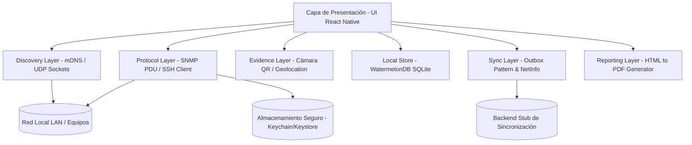
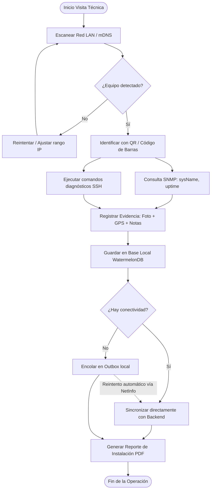

# Network Diagnostics Suite (TP6)
> **Toolkit móvil de diagnóstico de infraestructura de telecomunicaciones para técnicos de campo**  
> **Carrera:** Licenciatura en Sistemas de Información  
> **Cátedra:** Desarrollo de Aplicaciones Móviles (2026)  
> **Institución:** Facultad de Ciencia y Tecnología (FCyT) – Sede Concepción del Uruguay  
> **Área temática:** Comunicaciones y Redes de Datos | **Tecnología:** React Native

---

## 📌 Descripción del Proyecto

**Network Diagnostics Suite** es una solución móvil integral pensada como herramienta de campo para técnicos que instalan, auditan y mantienen infraestructura de telecomunicaciones (ONTs, routers, antenas, switches, firewalls). 

La aplicación opera directamente sobre **sockets de red a bajo nivel (TCP/UDP)** sin depender de capas HTTP tradicionales, e incorpora una arquitectura **Offline-First** resiliente orientada a escenarios remotos, azoteas, shelters o gabinetes donde la conectividad es nula o inestable.

---

## 🚀 Características Principales y Requisitos Funcionales

| ID | Módulo / Requisito | Descripción | Prioridad |
|---|---|---|---|
| **RF-01** | **Escaneo de Red Local** | Descubrimiento de hosts activos en la LAN por barrido/sockets y resolución mDNS/Bonjour. | **Alta** |
| **RF-02** | **Cliente SNMP v1/v2c** | Construcción de PDUs binarias sobre UDP/161 para consultar OIDs MIB-II (`sysName`, `sysDescr`, `uptime`). | **Alta** |
| **RF-03** | **Diagnóstico Remoto SSH** | Consola SSH embebida con comandos predefinidos de diagnóstico (`show interfaces`, `uptime`, etc.) y guardado seguro de credenciales con KeyStore/Keychain. | **Alta** |
| **RF-04** | **Escaneo de Códigos QR/Barras** | Identificación rápida de números de serie, MAC y vinculación a fichas técnicas de equipos. | **Media** |
| **RF-05** | **Relevamiento de Instalación** | Registro de auditoría con captura fotográfica, geolocalización GPS y notas técnicas. | **Alta** |
| **RF-06** | **Generación de Reportes PDF** | Exportación local de informes técnicos formateados listos para compartir con evidencia georreferenciada. | **Media** |
| **RF-07** | **Arquitectura Offline-First (Outbox)** | Persistencia local inmediata de acciones en una cola (*Outbox pattern*), sincronización diferida automática al recuperar red vía NetInfo. | **Alta** |
| **RF-08** | **Historial Técnico Local** | Consulta de auditorías y diagnósticos pasados sin requerir conexión a internet. | **Media** |

---

## 🏗️ Arquitectura del Sistema

La aplicación sigue un esquema desacoplado y estructurado en capas de dominio:



### Detalle de Capas:
1. **Discovery Layer (`src/discovery`):** Detección de dispositivos mediante `react-native-zeroconf` y barrido UDP/TCP.
2. **Protocol Layer (`src/protocols`):** 
   - **SNMP:** Parser e implementador de tramas BER/ASN.1 simplificadas para solicitudes `GetRequest` sobre UDP puerto 161.
   - **SSH:** Conexiones seguras mediante `react-native-ssh-sftp` con almacenamiento seguro de credenciales (`react-native-keychain`).
3. **Evidence Layer (`src/evidence`):** Captura de evidencia fotográfica, geolocalización satelital (`react-native-geolocation-service`) y lectura de códigos QR.
4. **Local Store (`src/database`):** Base de datos relacional local basada en **WatermelonDB** sobre SQLite, diseñada para rendimiento extremo y sincronización diferida.
5. **Sync Layer (`src/sync`):** Monitoreo del estado de red (`@react-native-community/netinfo`) y despacho por lotes (*flush*) de la cola `Outbox` al backend.
6. **Reporting Layer (`src/evidence/pdfReport.ts`):** Renderizado de plantillas HTML compiladas a documentos PDF con `react-native-html-to-pdf`.

---

## 🔄 Flujo Operativo (Técnico de Campo)



---

## 🛠️ Stack Tecnológico

### Aplicación Móvil (`/mobile`)
- **Framework:** React Native (CLI / Development Build) + TypeScript
- **Protocolos & Networking de bajo nivel:**
  - `react-native-udp`: Sockets UDP para consultas SNMP (PDU BER/ASN.1).
  - `react-native-tcp-socket`: Comunicación TCP y escaneos de socket.
  - `react-native-zeroconf`: Descubrimiento de servicios por mDNS/Bonjour.
  - `react-native-ssh-sftp`: Cliente SSH embebido.
- **Seguridad:**
  - `react-native-keychain`: Gestión segura de claves y credenciales en Keystore (Android) y Keychain (iOS).
- **Persistencia & Offline-First:**
  - `@nozbe/watermelondb`: Base de datos SQLite reactiva y transaccional.
  - `@react-native-community/netinfo`: Detección en tiempo real de conectividad de red.
- **Evidencia y Multimedia:**
  - `react-native-vision-camera`: Captura de cámara y escaneo de códigos QR.
  - `react-native-geolocation-service`: Coordenadas precisas para auditoría de campo.
  - `react-native-html-to-pdf`: Generador de reportes PDF.

### Backend Stub (`/backend`)
- **Runtime:** Node.js + Express
- **Contenerización:** Docker & Docker Compose
- **Funcionalidad:** Recepción de lotes de sincronización (`POST /api/sync`) y consulta de reportes consolidados (`GET /api/reports`).

---

## 📂 Estructura del Repositorio

```text
tp6-network-diagnostics-suite/
├── backend/                    # Backend stub de sincronización diferida
│   ├── Dockerfile
│   ├── docker-compose.yml
│   ├── package.json
│   └── server.js               # API REST con endpoints /api/sync y /api/reports
│
├── mobile/                     # Aplicación móvil en React Native
│   ├── assets/                 # Recursos estáticos y branding
│   ├── src/
│   │   ├── database/           # Modelos y esquemas de WatermelonDB (Device, Report, Outbox)
│   │   ├── discovery/          # Lógica de escaneo LAN y mDNS
│   │   ├── evidence/           # Servicios de fotos, ubicación GPS y generación de PDF
│   │   ├── protocols/          # Clientes de bajo nivel (SNMP PDU encoder/decoder, SSH)
│   │   ├── screens/            # Pantallas de la aplicación (Discovery, SSH, Install, History)
│   │   ├── sync/               # Servicio de sincronización offline-first y listener NetInfo
│   │   └── types/              # Definiciones TypeScript de dominio
│   ├── App.tsx                 # Contenedor principal con navegación por pestañas
│   ├── app.json
│   └── package.json
│
└── README.md                   # Documentación general del proyecto
```

---

## ⚙️ Guía de Puesta en Marcha

### 1. Iniciar el Backend Stub
El backend actúa como servidor central para recibir los datos de la cola outbox.

```bash
cd backend
# Opción 1: Con Docker Compose
docker compose up -d

# Opción 2: Localmente con Node.js
npm install
npm start
```
*El backend quedará escuchando en `http://localhost:3000` (Endpoints: `/health`, `/api/sync`, `/api/reports`).*

---

### 2. Configurar y Ejecutar la App Móvil

> [!IMPORTANT]
> **Compatibilidad con Expo Go:**  
> Dado que este proyecto utiliza bibliotecas nativas de bajo nivel (sockets crudos UDP/TCP, SSH y acceso al Keystore del sistema operativo), **no puede ejecutarse dentro de la app estándar de Expo Go**. Se requiere compilar una **Development Build** nativa o APK de prueba.

#### Instalación de dependencias:
```bash
cd mobile
npm install
```

#### Configuración de la IP de sincronización:
En [syncService.ts](file:///c:/Users/tobic/OneDrive/Documentos/Facu/4to%20A%C3%B1o%20Sistemas/Desarrollo%20App/tp6-network-diagnostics-suite/mobile/src/sync/syncService.ts#L7):
- Si ejecutas en el **Emulador Android**: Usa `http://10.0.2.2:3000`.
- Si pruebas en un **dispositivo móvil físico**: Coloca la IP privada de tu PC en la red local (ejemplo: `http://192.168.1.50:3000`).

### 2. Configurar y Ejecutar la App Móvil

La aplicación cuenta con una **capa de abstracción híbrida resiliente**:
- **En entorno nativo (APK / Development Client):** Opera sobre sockets UDP/TCP reales, libssh2 nativo, GPS satelital y hardware de seguridad Android Keystore.
- **En entorno de desarrollo / Demostración (Web / Expo):** Activa drivers y servicios simulados coherentes para permitir la navegación completa de la interfaz, el parser ASN.1, la persistencia en WatermelonDB y la sincronización con el backend stub sin requerir hardware físico ni Android Studio.

#### Instalación de dependencias:
```bash
cd mobile
npm install
```

#### Ejecutar para demostración (Video Demo):
```bash
# Iniciar en modo Web interactivo (óptimo para grabar video en la PC)
npm run web

# O iniciar con Expo Metro Bundler
npx expo start
```

---

### 3. Compilación de APK de Prueba en la Nube (EAS Build)
Para cumplir con el entregable del **APK** sin necesidad de tener instalado Android Studio ni SDK localmente:

1. Instalar la herramienta de Expo Application Services (si aún no la tienes):
   ```bash
   npm install -g eas-cli
   ```
2. Iniciar sesión en tu cuenta gratuita de Expo:
   ```bash
   eas login
   ```
3. Disparar la compilación del APK en los servidores en la nube:
   ```bash
   cd mobile
   eas build -p android --profile preview
   ```
*EAS Build compilará el instalador `.apk` de forma remota y al finalizar te entregará un enlace directo de descarga para entregar al profesor.*

---

## 🎬 Guión para la Grabación del Video Demo (3 a 5 min)
Para cumplir con todos los puntos solicitados por la cátedra:

1. **Terminal Backend:** Mostrar en una terminal el backend stub corriendo (`cd backend && node server.js`) en el puerto 3000.
2. **Descubrimiento LAN (RF-01):** En la pestaña **Descubrir**, presionar *Escanear Subred Local* o *mDNS / Bonjour*. Mostrar cómo se listan los equipos con su IP, MAC, Hostname y fabricante.
3. **Consulta SNMP MIB-II (RF-02):** En uno de los equipos detectados, presionar *Consultar SNMP (UDP/161)*. Mostrar la alerta y los datos de telemetría decodificados por el parser BER/ASN.1 (`sysName`, `uptime`, tráfico RX y TX).
4. **Consola SSH y Keystore (RF-03):** Ir a la pestaña **SSH**. Mostrar la barra de protección Keystore, abrir la configuración de credenciales y ejecutar comandos predefinidos (`uptime`, `show interfaces`). Mostrar la salida en la consola.
5. **Relevamiento, QR y Evidencia (RF-04 y RF-05):** Ir a la pestaña **Instalar**. 
   - Presionar el icono de cámara para escanear un QR (o simular selección de ONT Huawei).
   - Tocar en *Ver Ficha Técnica Remota* para exhibir las especificaciones completas del equipo.
   - Mostrar las coordenadas GPS satelitales y seleccionar una foto de evidencia de campo.
6. **Generación de Reporte PDF (RF-06):** Presionar *Generar Reporte PDF y Guardar*. En el modal, tocar *Ver PDF* para mostrar el documento técnico formateado con la foto y los datos georreferenciados.
7. **Offline-First y Sincronización Outbox (RF-07 y RF-08):** Ir a la pestaña **Historial**.
   - Mostrar el reporte recién creado en estado `⏳ En Outbox`.
   - Presionar *Sincronizar* (o verificar el auto-flush).
   - Mostrar cómo cambia de estado a `✓ Sincronizado` y cómo en la terminal del backend aparecen los logs del reporte recibido con éxito.

---

## 🔒 Consideraciones de Seguridad y Protocolos
- **SNMP v1/v2c:** Al operar sobre tramas binarias simplificadas (community strings en texto claro como `public`), se recomienda su uso exclusivamente en redes de gestión segmentadas (VLAN de administración / OAM).
- **Gestión de Credenciales SSH:** Las credenciales nunca son persistidas en texto plano en almacenamiento regular (`AsyncStorage` o SQLite plano). Se protegen mediante el hardware de seguridad del dispositivo a través de `react-native-keychain` (Keystore de Android / Keychain de iOS).
